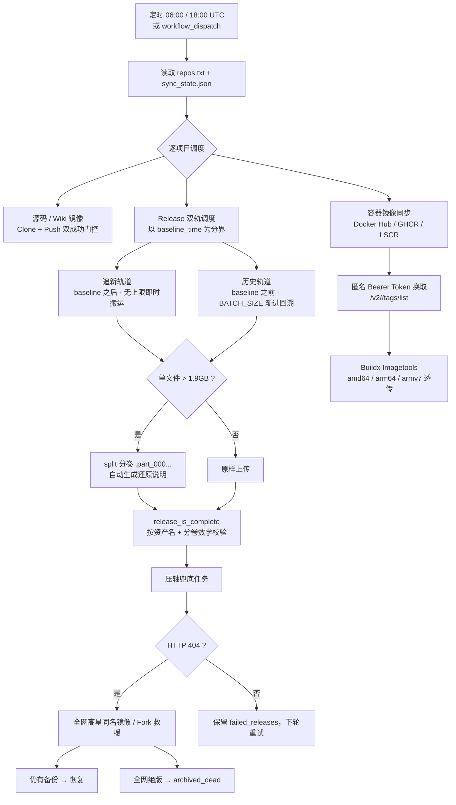

<div align="center">

<!-- 顶部高定渐变 Banner -->


<p align="center">
  <strong>为关键开源基础设施提供源码、Wiki、全量 Release 二进制及多架构容器镜像的永久性容灾归档</strong>
</p>

<!-- 徽章矩阵 -->
<p align="center">
  <a href="../../actions"></a>
  <a href="../../packages"></a>
  <a href="./sync_state.json"></a>
  <a href="./batch-mirror.yml"></a>
  <a href="./LICENSE"></a>
</p>

<!-- 多语言切换 -->
<p align="center">
  <strong>简体中文</strong> &nbsp;·&nbsp;
  <a href="./README_TW.md">繁體中文</a> &nbsp;·&nbsp;
  <a href="./README_EN.md">English</a> &nbsp;·&nbsp;
  <a href="./README_JA.md">日本語</a> &nbsp;·&nbsp;
  <a href="./README_KO.md">한국어</a>
</p>

<!-- 快捷入口 -->
<p align="center">
  <a href="../../wiki"><strong>📖 Wiki 文档</strong></a> &nbsp;|&nbsp;
  <a href="./repos.txt"><strong>⚙️ 镜像清单</strong></a> &nbsp;|&nbsp;
  <a href="./sync_state.json"><strong>📊 状态账本</strong></a> &nbsp;|&nbsp;
  <a href="../../issues"><strong>🐛 问题反馈</strong></a>
</p>

</div>

<br/>

## 概述

上游仓库突然删库、历史 Release 附件被清理、单文件突破 GitHub `2GB` 限制、多架构容器镜像拉取受限——这些都是自托管与企业内网基础设施面临的真实单点故障风险。

**OmniMirror Hub** 不是简单的定时同步脚本，而是一套经过生产级极限压测的**全量渐进式容灾总控架构**。它通过**双轨并发调度**、**1.9GB 智能二进制分卷**、**数学级资产完整性校验**以及**全网 404 自动抢救机制**，在完全零人工干预的前提下，把上游动态演进的软件资产沉淀为永久可控的私有/公有镜像库。

<br/>

## 核心架构



<br/>

## 核心能力

<table>
  <tr>
    <td width="50%" valign="top">
      <h3>⚡ 双轨制并发调度引擎</h3>
      <p>以首次建档锁定的 <code>baseline_time</code> 为分界线：<strong>追新轨道</strong>对之后新发布的 Release 零延迟、无上限搬运；<strong>历史轨道</strong>对之前的存量版本按 <code>BATCH_SIZE</code>（默认每轮 15 个）渐进回溯，既规避 GitHub API 5000/h 限流，又能长周期 100% 归档。</p>
    </td>
    <td width="50%" valign="top">
      <h3>✂️ 突破 2GB：分卷 + 数学校验</h3>
      <p>单文件超过 <code>1.9GB</code> 自动执行 <code>split</code> 二进制分卷（<code>.part_000...</code>），并在 Release 说明中生成 Linux/macOS 与 Windows CMD 一键还原命令。<code>release_is_complete</code> 按源端字节数精确推算分卷数 N，自动识别并重建半成品，零误伤。</p>
    </td>
  </tr>
  <tr>
    <td width="50%" valign="top">
      <h3>🚑 Anti-404 全网救援</h3>
      <p>严格区分 <code>403/429/5xx</code> 瞬时限流与真实 <code>404</code> 删库/删版本。目标仓库已入库的绝版资产受绝对保护；确认源端 <code>404</code> 且本地缺失时，自动检索全网高星同名镜像/Fork 抢救，仍无备份才归档 <code>archived_dead</code>。</p>
    </td>
    <td width="50%" valign="top">
      <h3>🐳 跨源多架构透传</h3>
      <p>支持 Docker Hub、GHCR（<code>ghcr.io</code>）、LinuxServer（<code>lscr.io</code>）等主流 Registry。匿名 Bearer Token 自动换取 + <code>/v2/&lt;repo&gt;/tags/list</code> 真实标签查询，基于 Buildx Imagetools 实现 <code>amd64</code> / <code>arm64</code> / <code>armv7</code> 多架构 Manifest 秒级透传。</p>
    </td>
  </tr>
  <tr>
    <td width="50%" valign="top">
      <h3>🔒 工业级并发锁与原子账本</h3>
      <p>全局 <code>concurrency</code> 队列锁 + <code>fetch-depth: 0</code> + <code>safe_jq</code> 原子写入校验，杜绝多任务并发冲突与 <code>sync_state.json</code> 损坏。</p>
    </td>
    <td width="50%" valign="top">
      <h3>⏱️ 熔断保护与保活</h3>
      <p>主流程 5 小时（18000s）优雅熔断，5 小时 40 分钟（20400s）全局安全红线收尾提交，自动保活记录防止 60 天无操作停用。</p>
    </td>
  </tr>
</table>

<br/>

## 为什么选择 OmniMirror Hub？

| 评估维度 | 传统同步脚本 | **OmniMirror Hub** |
| :--- | :--- | :--- |
| **大仓库源码同步** | 超时中断即丢失进度，甚至误记为已同步 | **Clone + Push 双成功门控**，失败自动断点重试 |
| **超大 Release 附件** | 触发 GitHub 2GB 单文件限制直接报错 | **1.9GB 自动二进制分卷**，随附全平台还原指令 |
| **半成品残缺修复** | 检测到同名 Tag 即跳过，残缺 Release 永久留存 | **按资产名 + 分卷数学公式校验**，自动清除重建 |
| **上游删库/删版本** | 遇 404 中断，或误删本地已有存档 | **本地绝版资产绝对保护** + 全网同名高星库救援 |
| **并发与账本安全** | 多任务并发导致 JSON 冲突损坏 | **全局 Concurrency 锁** + `safe_jq` 原子写 |

<br/>

## 快速开始

### 1. 配置访问凭证

前往仓库 **`Settings` → `Secrets and variables` → `Actions`**，新增：

| Secret | 权限 | 用途 |
| :--- | :--- | :--- |
| `MIRROR_TOKEN` | `repo`, `workflow`, `write:packages` | 创建镜像仓库、推送源码/Wiki、发布 Release、推送容器镜像 |

### 2. 定义同步清单 `repos.txt`

```text
# 格式：GitHub源仓库 | 容器镜像源 | 目标仓库名 | 镜像拉取最近Tag数
n8n-io/n8n          | docker.n8n.io/n8nio/n8n | n8n      | 10
langgenius/dify     | langgenius/dify-api      | dify-api | 15
none                | langgenius/dify-web      | dify-web | 15
siyuan-note/siyuan  | b3log/siyuan             | siyuan   | 10
```

- 支持 `#` 注释与空行；
- 纯镜像项目第一列写 `none`；
- 详见 [配置指南](https://github.com/OWNER/REPO/wiki/Configuration-Guide)。

### 3. 启动工作流

- **周期调度**：每日 `06:00 UTC` 与 `18:00 UTC` 自动巡检；
- **手动触发**：`Actions` → `全量渐进式总控搬运` → `Run workflow`，可传 `batch_size`（默认 `15`）。

<br/>

## 进阶说明

<details>
<summary><strong>📦 如何还原超过 1.9GB 的自动分卷文件？</strong></summary>
<br/>

系统会将超过 `1.9GB` 的单文件切割为 `filename.ext.part_000`、`filename.ext.part_001`…。把同一文件全部分卷下载到同一目录后合并：

* **Linux / macOS**
  ```bash
  cat filename.ext.part_* > filename.ext
  ```
* **Windows CMD**
  ```cmd
  copy /b filename.ext.part_* filename.ext
  ```
</details>

<details>
<summary><strong>📊 如何阅读状态账本 <code>sync_state.json</code>？</strong></summary>
<br/>

由 `safe_jq` 原子维护，核心字段：

| 字段 | 含义 |
| :--- | :--- |
| `baseline_time` | 首次建档时间，区分追新/历史轨道的基准线 |
| `synced_releases` | 已通过完整性校验并归档的 Release Tag |
| `failed_releases` | 瞬时失败队列，压轴兜底任务自动重试 |
| `archived_dead` | 全网确认绝版后的归档记录 |
| `synced_images` | 镜像 Tag → `{digest, sync_time}` |
| `last_repo_push` | 上次源码镜像成功时的 `pushed_at` |
| `repo_dead` | 源码仓库确认 404 的标记（每轮仍会复核） |
| `history_completed` | 历史版本是否全部归档的人读标记 |

</details>

<details>
<summary><strong>🛡️ 熔断与配额保护机制</strong></summary>
<br/>

* **主流程熔断**：运行满 `18000s`（5h）优雅暂停并保存进度，让位给兜底阶段；
* **全局安全红线**：`20400s`（5h40m）强制收尾提交，避免 GitHub Actions 6h 强杀丢进度；
* **保活**：每轮写入 `.github/.last_run`，防止 60 天无操作停用。

</details>

<details>
<summary><strong>🔁 历史假成功的无损体检（可选）</strong></summary>
<br/>

若怀疑旧版曾把半成品误记入 `synced_releases`，可将其临时回填到 `failed_releases` 触发新版完整性复检：

```bash
cp sync_state.json "sync_state.json.bak.$(date +%Y%m%d%H%M%S)"
jq 'with_entries(.value |= (
  .failed_releases = ((.failed_releases // []) + ((.synced_releases // []) | map({"tag": .}))) | unique_by(.tag)
  | .synced_releases = []
  | .history_completed = false
))' sync_state.json > tmp.json && mv tmp.json sync_state.json
```

完整的版本会秒过复检并回填 `synced_releases`；残缺版本自动删除重建。详见 [故障排查手册](https://github.com/OWNER/REPO/wiki/Troubleshooting-and-Maintenance)。

</details>

<br/>

## 文档导航

* **[Wiki 首页](https://github.com/OWNER/REPO/wiki)** — 系统全景与概念总览
* **[配置指南](https://github.com/OWNER/REPO/wiki/Configuration-Guide)** — `repos.txt` 全场景与密钥权限
* **[架构与算法](https://github.com/OWNER/REPO/wiki/Architecture-and-Algorithms)** — 双轨调度、分卷数学校验、Anti-404
* **[故障排查与运维](https://github.com/OWNER/REPO/wiki/Troubleshooting-and-Maintenance)** — 账本字段、体检恢复、限流应对

<br/>

<div align="center">
  
</div>
