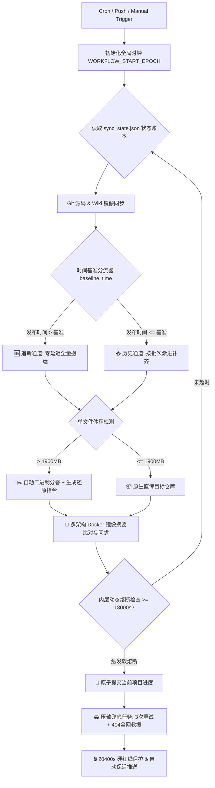

<div align="center">

<h1>⚡ MIRROR HUB</h1>

<p>
  <strong>企业级开源资产自动化镜像、容灾归档与全网救援引擎</strong>
</p>

<p>
  <b>简体中文</b> &nbsp;•&nbsp;
  <a href="./README.zh-TW.md">繁體中文</a> &nbsp;•&nbsp;
  <a href="./README.en.md">English</a> &nbsp;•&nbsp;
  <a href="./README.ja.md">日本語</a> &nbsp;•&nbsp;
  <a href="./README.ko.md">한국어</a>
</p>

<p align="center">
  <a href="../../actions"><code>⚡ Engine: GitHub Actions</code></a> &nbsp;•&nbsp;
  <a href="./.github/workflows/batch-mirror.yml"><code>🔄 Mode: Dual-Track Incremental</code></a> &nbsp;•&nbsp;
  <a href="https://ghcr.io"><code>🐳 Registry: GHCR.io</code></a> &nbsp;•&nbsp;
  <a href="./sync_state.json"><code>📒 Ledger: sync_state.json</code></a>
</p>

</div>

---

### 🏗️ 系统架构与执行流 (System Architecture)



---

### 📊 核心工程能力矩阵

| 架构维度 | 传统搬运脚本痛点 | Mirror Hub 工程级解决方案 |
| :--- | :--- | :--- |
| **超时控制** | 撞上 GitHub 6 小时硬杀，已同步进度全部丢失 | **三层动态熔断**：外层/内层双循环实时探针 + 动态剩余时间计算 + 20 分钟安全缓冲 |
| **超大文件** | 单文件超 2GB 触发接口报错，版本永久缺失 | **流式二进制分卷**：自动识别 `>1900MB` 资产，无损切割为 `.part_000` 并注入还原手册 |
| **增量策略** | 全量遍历 API 极易触发速率限制 (Rate Limit) | **双轨制时间基准**：锁定 `baseline_time`，新版本实时追新，历史版本批次消化 |
| **源站删库** | 源仓库或历史 Tag 被删（404）后彻底失联 | **全网救援引擎**：自动检索 GitHub 全网高星备份库抢救恢复，绝版资产归档至 `archived_dead` |
| **并发安全** | 运行期间修改清单导致末尾 `git push` 冲突报错 | **乐观锁变基重试**：自动执行 `git pull --rebase --autostash` 三次退避重试 |

---

### 🚀 快速部署指南

#### 1. 配置权限密钥 (`MIRROR_TOKEN`)
进入仓库 `Settings` ➔ `Secrets and variables` ➔ `Actions` ➔ `New repository secret`：
- **Name**: `MIRROR_TOKEN`
- **Scopes**: 必须勾选 `repo`、`workflow`、`write:packages`、`read:packages`

#### 2. 定义同步拓扑 (`repos.txt`)
```text
# 语法规范：源GitHub仓库 | 源Docker镜像 | 目标仓库名 | 每次同步Docker标签数
# 无对应源请填写 none
dify-ai/dify | langgenius/dify-api | dify | 5
n8n-io/n8n | n8nio/n8n | n8n | 5
torvalds/linux | none | linux-kernel | 0
```

<details>
<summary><b>🧩 点击展开：超大文件分卷 (>2GB) 还原协议</b></summary>
<br>

当上游 Release 包含超过 `1900MB` 的单一资产时，系统会自动生成 `文件名.part_000`、`文件名.part_001` 等分卷，并在对应 Release 页面底部注入校验指引。下载全部分卷至同一目录后执行：

- **Linux / macOS (POSIX)**:
  ```bash
  cat 文件名.part_* > 文件名
  ```
- **Windows (CMD)**:
  ```cmd
  copy /b 文件名.part_* 文件名
  ```
</details>
