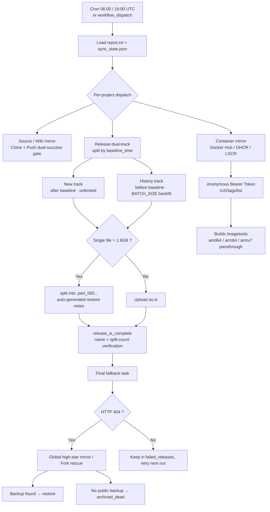

<div align="center">

<!-- Hero banner -->


<p align="center">
  <strong>Permanent disaster-recovery archiving for source code, wikis, full Release binaries and multi-arch container images of critical open-source infrastructure.</strong>
</p>

<!-- Dual-tone badges -->
<p align="center">
  <a href="../../actions"></a>
  <a href="./sync_state.json"></a>
  <a href="./batch-mirror.yml">1.9GB CHUNKS"></a>
  <a href="../../wiki/Troubleshooting-and-Maintenance"></a>
  <a href="../../packages"></a>
</p>

<!-- Language switcher -->
<p align="center">
  <a href="../../">简体中文</a> &nbsp;│&nbsp;
  <a href="./README_TW.md">繁體中文</a> &nbsp;│&nbsp;
  <strong>English</strong> &nbsp;│&nbsp;
  <a href="./README_JA.md">日本語</a> &nbsp;│&nbsp;
  <a href="./README_KO.md">한국어</a>
</p>

<!-- Quick links -->
<p align="center">
  <a href="../../wiki"><strong>📖 Wiki</strong></a> &nbsp;│&nbsp;
  <a href="./repos.txt"><strong>⚙️ Mirror Manifest</strong></a> &nbsp;│&nbsp;
  <a href="./sync_state.json"><strong>📊 State Ledger</strong></a> &nbsp;│&nbsp;
  <a href="../../issues"><strong>🐛 Issues</strong></a>
</p>

</div>

---

## Overview

Upstream repositories get deleted, historical Release assets get purged, single files exceed GitHub's `2GB` limit, and multi-arch container images become hard to pull — these are real single points of failure for self-hosted and enterprise intranet infrastructure.

**OmniMirror Hub** is not a simple scheduled sync script. It is a **full, progressive disaster-recovery control plane** stress-tested to production limits. Through **dual-track scheduling**, **1.9GB smart binary splitting**, **mathematical asset-integrity verification**, and **global 404 rescue**, it turns upstream assets into a permanently controllable private/public mirror library with zero manual intervention.

---

## Architecture



---

## Core Capabilities

<table>
  <tr>
    <td width="50%" valign="top">
      <h3>⚡ Dual-track scheduling engine</h3>
      <p>Using the first-build <code>baseline_time</code> as the split line: the <strong>new track</strong> mirrors every new Release with zero delay and no cap; the <strong>history track</strong> backfills legacy versions by <code>BATCH_SIZE</code> (default 15 per run), evading the GitHub API 5000/h limit while still archiving 100% over time.</p>
    </td>
    <td width="50%" valign="top">
      <h3>✂️ Beating 2GB: split + verification</h3>
      <p>Files over <code>1.9GB</code> are split with <code>split</code> binary chunking (<code>.part_000...</code>) and one-line restore commands for Linux/macOS and Windows CMD are written into the Release notes. <code>release_is_complete</code> computes the expected part count N from source byte sizes, detects and rebuilds partial Releases with zero collateral damage.</p>
    </td>
  </tr>
  <tr>
    <td width="50%" valign="top">
      <h3>🚑 Anti-404 global rescue</h3>
      <p>Strictly separates <code>403/429/5xx</code> transient throttling from real <code>404</code> deletions. Already-mirrored assets are absolutely protected; when the source is confirmed <code>404</code> and the local copy is missing, it searches high-star mirrors/forks globally and only then archives to <code>archived_dead</code>.</p>
    </td>
    <td width="50%" valign="top">
      <h3>🐳 Cross-registry multi-arch passthrough</h3>
      <p>Supports Docker Hub, GHCR (<code>ghcr.io</code>), LinuxServer (<code>lscr.io</code>) and more. Anonymous Bearer Token exchange + real <code>/v2/&lt;repo&gt;/tags/list</code> lookups, with Buildx Imagetools giving <code>amd64</code> / <code>arm64</code> / <code>armv7</code> manifest passthrough without rebuilding.</p>
    </td>
  </tr>
  <tr>
    <td width="50%" valign="top">
      <h3>🔒 Concurrency lock & atomic ledger</h3>
      <p>Global <code>concurrency</code> queue lock + <code>fetch-depth: 0</code> + <code>safe_jq</code> atomic write validation eliminate concurrent conflicts and <code>sync_state.json</code> corruption.</p>
    </td>
    <td width="50%" valign="top">
      <h3>⏱️ Circuit breaking & keep-alive</h3>
      <p>A 5-hour (18000s) graceful main-loop cut-off, a 5h40m (20400s) global safety line for final commit, and automatic keep-alive to prevent 60-day auto-disable.</p>
    </td>
  </tr>
</table>

---

## Why OmniMirror Hub?

| Dimension | Typical sync scripts | **OmniMirror Hub** |
| :--- | :--- | :--- |
| **Large source repos** | Timeout loses progress, sometimes falsely marked synced | **Clone + Push dual-success gate**, auto retry |
| **Huge Release assets** | Fails on GitHub's 2GB per-file limit | **1.9GB auto binary split** + cross-platform restore commands |
| **Partial Releases** | Existing tag → skipped forever | **Name + split math verification**, auto delete & rebuild |
| **Upstream deletion** | 404 aborts, or local archive wrongly deleted | **Absolute protection of local archives** + global rescue |
| **Concurrency & ledger** | Concurrent runs corrupt JSON | **Global Concurrency lock** + `safe_jq` atomic writes |

---

## Quick Start

### 1. Configure credentials

Go to **`Settings` → `Secrets and variables` → `Actions`** and add:

| Secret | Permissions | Purpose |
| :--- | :--- | :--- |
| `MIRROR_TOKEN` | `repo`, `workflow`, `write:packages` | Create mirror repos, push source/wiki, publish Releases, push images |

### 2. Define the manifest `repos.txt`

```text
# Format: GitHub source | container image source | target repo | latest image tags to keep
n8n-io/n8n          | docker.n8n.io/n8nio/n8n | n8n      | 10
langgenius/dify     | langgenius/dify-api      | dify-api | 15
none                | langgenius/dify-web      | dify-web | 15
siyuan-note/siyuan  | b3log/siyuan             | siyuan   | 10
```

- `#` comments and blank lines are supported;
- Use `none` in the first column for image-only projects;
- See the [Configuration Guide](https://github.com/OWNER/REPO/wiki/Configuration-Guide).

### 3. Run the workflow

- **Scheduled**: daily at `06:00 UTC` and `18:00 UTC`;
- **Manual**: `Actions` → `全量渐进式总控搬运` → `Run workflow`, optionally pass `batch_size` (default `15`).

---

## Advanced

<details>
<summary><strong>📦 How to restore a split file over 1.9GB?</strong></summary>
<br/>

Files over `1.9GB` are split into `filename.ext.part_000`, `filename.ext.part_001`… Download all parts into one directory and merge:

```bash
# Linux / macOS
cat filename.ext.part_* > filename.ext
```

```cmd
:: Windows CMD
copy /b filename.ext.part_* filename.ext
```

</details>

<details>
<summary><strong>📊 How to read <code>sync_state.json</code>?</strong></summary>
<br/>

Maintained atomically by `safe_jq`. Key fields:

| Field | Meaning |
| :--- | :--- |
| `baseline_time` | First-build time; the new/history split line |
| `synced_releases` | Release tags verified and archived |
| `failed_releases` | Transient failures, retried by the fallback task |
| `archived_dead` | Records confirmed as globally gone |
| `synced_images` | Image tag → `{digest, sync_time}` |
| `last_repo_push` | Source `pushed_at` of the last successful mirror |
| `repo_dead` | Marker for a 404 source repo (re-checked each run) |
| `history_completed` | Human-readable "history fully archived" flag |

</details>

<details>
<summary><strong>🛡️ Circuit breakers & quota protection</strong></summary>
<br/>

* **Main-loop cut-off**: at `18000s` (5h) it pauses gracefully and saves progress for the fallback phase;
* **Global safety line**: at `20400s` (5h40m) it forces a final commit, avoiding data loss from GitHub Actions' 6h kill;
* **Keep-alive**: writes `.github/.last_run` each run to avoid the 60-day disable.

</details>

<details>
<summary><strong>🔁 Non-destructive audit of historical false successes (optional)</strong></summary>
<br/>

If you suspect an older version falsely marked partial Releases as synced, temporarily move them back into `failed_releases` to trigger the new completeness check:

```bash
cp sync_state.json "sync_state.json.bak.$(date +%Y%m%d%H%M%S)"
jq 'with_entries(.value |= (
  .failed_releases = ((.failed_releases // []) + ((.synced_releases // []) | map({"tag": .}))) | unique_by(.tag)
  | .synced_releases = []
  | .history_completed = false
))' sync_state.json > tmp.json && mv tmp.json sync_state.json
```

Complete releases pass instantly and return to `synced_releases`; partial ones are deleted and rebuilt. See the [Troubleshooting guide](https://github.com/OWNER/REPO/wiki/Troubleshooting-and-Maintenance).

</details>

---

## Documentation

| Document | Contents |
| :--- | :--- |
| **[Wiki Home](https://github.com/OWNER/REPO/wiki)** | System overview |
| **[Configuration Guide](https://github.com/OWNER/REPO/wiki/Configuration-Guide)** | `repos.txt` scenarios & permissions |
| **[Architecture & Algorithms](https://github.com/OWNER/REPO/wiki/Architecture-and-Algorithms)** | Dual-track, split verification, Anti-404 |
| **[Troubleshooting & Maintenance](https://github.com/OWNER/REPO/wiki/Troubleshooting-and-Maintenance)** | Ledger fields, audit & recovery, rate limits |

<br/>

<div align="center">
  <sub>© 2025 OmniMirror Hub · Released under the MIT License · Powered by GitHub Actions</sub>
</div>

<!-- Footer waving banner (mirrors the hero) -->
<div align="center">
  
</div>
