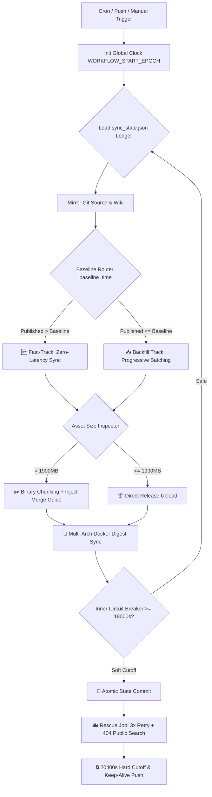

<div align="center">

<h1>⚡ MIRROR HUB</h1>

<p>
  <strong>Enterprise-Grade Autonomous Asset Mirroring, Disaster Recovery & Cross-Repo Rescue Engine</strong>
</p>

<p>
  <a href="./README.md">简体中文</a> &nbsp;•&nbsp;
  <a href="./README_TW.md">繁體中文</a> &nbsp;•&nbsp;
  <a href="./README_EN.md"><b>English</b></a> &nbsp;•&nbsp;
  <a href="./README_JA.md">日本語</a> &nbsp;•&nbsp;
  <a href="./README_KO.md">한국어</a>
</p>

<p>
  <code>Engine: GitHub Actions</code> &nbsp;|&nbsp;
  <code>State Machine: JSON Ledger</code> &nbsp;|&nbsp;
  <code>Chunking: >1.9GB Auto-Split</code> &nbsp;|&nbsp;
  <code>Rescue: Cross-Repo 404 Recovery</code>
</p>

</div>

---

### 🏗️ System Architecture & Execution Flow



---

### 📊 Engineering Capability Matrix

| Dimension | Legacy Mirror Scripts | Mirror Hub Architecture |
| :--- | :--- | :--- |
| **Timeout Safety** | Killed abruptly at GitHub's 6h limit; progress lost | **3-Tier Circuit Breaker**: Inner/outer loop probes + dynamic `REM_SEC` calculation + 20m buffer |
| **Large Assets** | Fails permanently on files >2GB due to API limits | **Lossless Binary Split**: Auto-chunks `>1900MB` assets into `.part_000` with merge commands |
| **Sync Strategy** | Full API scans trigger rate limits rapidly | **Dual-Track Baseline**: Locks `baseline_time` for instant new releases & batched history |
| **Upstream 404** | Assets lost forever if upstream deletes repo/tag | **Cross-Repo Rescue**: Searches top public GitHub mirrors; archives dead tags in `archived_dead` |
| **Concurrency** | Manual edits during runs cause `git push` failures | **Optimistic Rebase**: Executes 3x backoff retries with `git pull --rebase --autostash` |

---

### 🚀 Quick Deployment

#### 1. Configure Secret (`MIRROR_TOKEN`)
Go to `Settings` ➔ `Secrets and variables` ➔ `Actions` ➔ `New repository secret`:
- **Name**: `MIRROR_TOKEN`
- **Scopes**: `repo`, `workflow`, `write:packages`, `read:packages`

#### 2. Define Topology (`repos.txt`)
```text
# Syntax: SOURCE_GH_REPO | SOURCE_DOCKER_IMAGE | TARGET_REPO_NAME | DOCKER_TAG_COUNT
# Use "none" if not applicable
dify-ai/dify | langgenius/dify-api | dify | 5
n8n-io/n8n | n8nio/n8n | n8n | 5
torvalds/linux | none | linux-kernel | 0
```

<details>
<summary><b>🧩 Expand: Large File (>2GB) Reconstruction Protocol</b></summary>
<br>

Assets exceeding `1900MB` are automatically split into `filename.part_000`, `filename.part_001`, etc. Download all parts into the same directory and run:

- **Linux / macOS (POSIX)**:
  ```bash
  cat filename.part_* > filename
  ```
- **Windows (CMD)**:
  ```cmd
  copy /b filename.part_* filename
  ```
</details>
