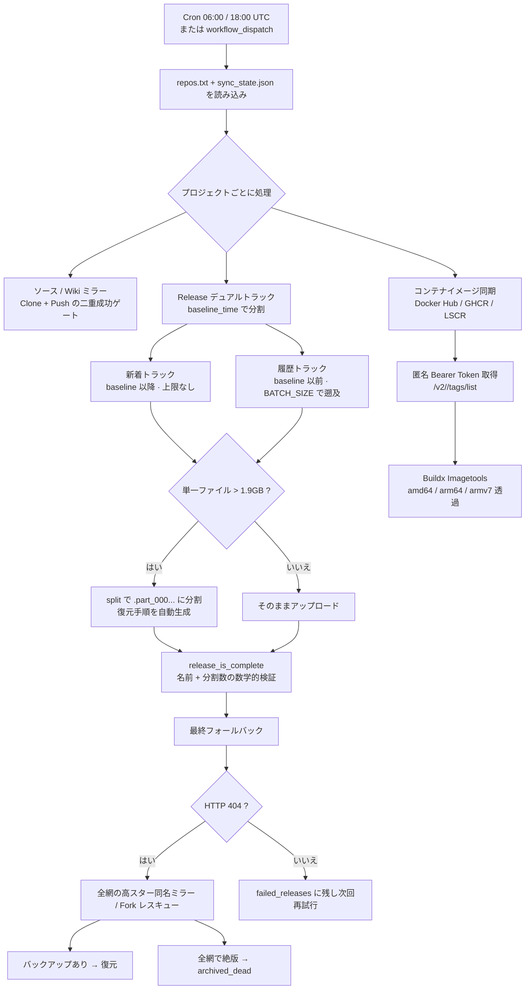

<div align="center">

<!-- ヒーローバナー -->


<p align="center">
  <strong>重要なオープンソース基盤のソースコード・Wiki・全 Release バイナリ・マルチアーキテクチャコンテナイメージを永久にアーカイブします。</strong>
</p>

<!-- デュアルトーンバッジ -->
<p align="center">
  <a href="../../actions"></a>
  <a href="./sync_state.json"></a>
  <a href="./batch-mirror.yml">1.9GB CHUNKS"></a>
  <a href="../../wiki/Troubleshooting-and-Maintenance"></a>
  <a href="../../packages"></a>
</p>

<!-- 言語切り替え -->
<p align="center">
  <a href="../../">简体中文</a> &nbsp;│&nbsp;
  <a href="./README_TW.md">繁體中文</a> &nbsp;│&nbsp;
  <a href="./README_EN.md">English</a> &nbsp;│&nbsp;
  <strong>日本語</strong> &nbsp;│&nbsp;
  <a href="./README_KO.md">한국어</a>
</p>

<!-- クイックリンク -->
<p align="center">
  <a href="../../wiki"><strong>📖 Wiki</strong></a> &nbsp;│&nbsp;
  <a href="./repos.txt"><strong>⚙️ ミラー一覧</strong></a> &nbsp;│&nbsp;
  <a href="./sync_state.json"><strong>📊 状態台帳</strong></a> &nbsp;│&nbsp;
  <a href="../../issues"><strong>🐛 問題報告</strong></a>
</p>

</div>

---

## 概要

上流リポジトリの突然の削除、過去 Release 添付ファイルの消去、単一ファイルの GitHub `2GB` 制限超過、マルチアーキテクチャイメージの取得制限——これらはセルフホストや企業内ネットワーク基盤が直面する現実的な単一障害点です。

**OmniMirror Hub** は単なる定時同期スクリプトではありません。本番レベルの限界試験を経た**全量漸進型ディザスタリカバリ制御アーキテクチャ**です。**デュアルトラック・スケジューリング**、**1.9GB スマートバイナリ分割**、**数学的アセット完全性検証**、**全網 404 自動レスキュー**により、人手を一切介さず上流の資産を恒久的に管理可能なミラーライブラリへと蓄積します。

---

## アーキテクチャ



---

## 主要機能

<table>
  <tr>
    <td width="50%" valign="top">
      <h3>⚡ デュアルトラック・スケジューリング</h3>
      <p>初回構築時の <code>baseline_time</code> を境界に、<strong>新着トラック</strong>は以降の Release を遅延なく上限なしで同期、<strong>履歴トラック</strong>は以前の版を <code>BATCH_SIZE</code>（既定 15/回）で漸進的に遡及し、GitHub API 5000/h 制限を回避しつつ最終的に 100% をアーカイブします。</p>
    </td>
    <td width="50%" valign="top">
      <h3>✂️ 2GB 制限の突破と検証</h3>
      <p><code>1.9GB</code> を超えるファイルは <code>split</code> で分割（<code>.part_000...</code>）し、Linux/macOS と Windows CMD の復元コマンドを Release 説明に自動記載。<code>release_is_complete</code> がソースのバイト数から必要分割数 N を算出し、中断で生じた半端な Release を検出・再構築します。</p>
    </td>
  </tr>
  <tr>
    <td width="50%" valign="top">
      <h3>🚑 Anti-404 全網レスキュー</h3>
      <p><code>403/429/5xx</code> の一時制限と真の <code>404</code> 削除を厳密に区別。既にミラー済みの絶版資産は絶対保護され、ソースが <code>404</code> かつローカル未同期のときのみ全網の高スター同名ミラー/Fork を検索し、それでも無ければ <code>archived_dead</code> にアーカイブします。</p>
    </td>
    <td width="50%" valign="top">
      <h3>🐳 クロスレジストリ・マルチアーチ</h3>
      <p>Docker Hub、GHCR（<code>ghcr.io</code>）、LinuxServer（<code>lscr.io</code>）等に対応。匿名 Bearer Token の取得と実タグ照会（<code>/v2/&lt;repo&gt;/tags/list</code>）を行い、Buildx Imagetools で <code>amd64</code> / <code>arm64</code> / <code>armv7</code> の Manifest を再ビルドなしで透過します。</p>
    </td>
  </tr>
  <tr>
    <td width="50%" valign="top">
      <h3>🔒 並行ロックと原子台帳</h3>
      <p>グローバル <code>concurrency</code> キュー + <code>fetch-depth: 0</code> + <code>safe_jq</code> 原子書き込み検証で、並行競合と <code>sync_state.json</code> 破損を防ぎます。</p>
    </td>
    <td width="50%" valign="top">
      <h3>⏱️ サーキットブレーカーとキープアライブ</h3>
      <p>メイン処理は 5 時間（18000s）で優雅に停止し、5 時間 40 分（20400s）の安全ラインで最終コミット。60 日無操作による無効化も防止します。</p>
    </td>
  </tr>
</table>

---

## なぜ OmniMirror Hub なのか

| 観点 | 一般的な同期スクリプト | **OmniMirror Hub** |
| :--- | :--- | :--- |
| **大規模ソース同期** | タイムアウトで進捗喪失、誤って同期済み扱いも | **Clone + Push 二重成功ゲート**、自動再試行 |
| **巨大 Release 添付** | GitHub の 2GB 制限で即エラー | **1.9GB 自動分割** + 全プラットフォーム復元手順 |
| **半端な Release** | 同名タグがあれば永久にスキップ | **名前 + 分割数の数学検証**で削除・再構築 |
| **上流の削除** | 404 で中断、またはローカル保存を誤削除 | **ローカル絶版資産を絶対保護** + 全網レスキュー |
| **並行性と台帳** | 並行実行で JSON が破損 | **グローバル Concurrency ロック** + `safe_jq` 原子書き込み |

---

## クイックスタート

### 1. 認証情報の設定

**`Settings` → `Secrets and variables` → `Actions`** で以下を追加：

| Secret | 権限 | 用途 |
| :--- | :--- | :--- |
| `MIRROR_TOKEN` | `repo`, `workflow`, `write:packages` | リポジトリ作成、ソース/Wiki プッシュ、Release 公開、イメージプッシュ |

### 2. 同期リスト `repos.txt`

```text
# 形式：GitHub ソース | コンテナイメージソース | ターゲットリポジトリ | 保持する最新タグ数
n8n-io/n8n          | docker.n8n.io/n8nio/n8n | n8n      | 10
langgenius/dify     | langgenius/dify-api      | dify-api | 15
none                | langgenius/dify-web      | dify-web | 15
siyuan-note/siyuan  | b3log/siyuan             | siyuan   | 10
```

- `#` コメントと空行に対応；
- イメージのみのプロジェクトは 1 列目に `none`；
- 詳細は [設定ガイド](https://github.com/OWNER/REPO/wiki/Configuration-Guide)。

### 3. ワークフローの起動

- **定期実行**：毎日 `06:00 UTC` と `18:00 UTC`；
- **手動実行**：`Actions` → `全量渐进式总控搬运` → `Run workflow`、`batch_size`（既定 `15`）を指定可能。

---

## 高度な使い方

<details>
<summary><strong>📦 1.9GB を超える分割ファイルの復元方法</strong></summary>
<br/>

`1.9GB` を超えるファイルは `filename.ext.part_000`、`filename.ext.part_001`… に分割されます。全パートを同一ディレクトリにダウンロードして結合します：

```bash
# Linux / macOS
cat filename.ext.part_* > filename.ext
```

```cmd
:: Windows CMD
copy /b filename.ext.part_* filename.ext
```

</details>

<details>
<summary><strong>📊 状態台帳 <code>sync_state.json</code> の読み方</strong></summary>
<br/>

`safe_jq` により原子的に維持されます。主要フィールド：

| フィールド | 意味 |
| :--- | :--- |
| `baseline_time` | 初回構築時刻。新着/履歴の境界 |
| `synced_releases` | 完全性検証済みでアーカイブした Release タグ |
| `failed_releases` | 一時失敗キュー。フォールバックで再試行 |
| `archived_dead` | 全網で絶版と確認した記録 |
| `synced_images` | イメージタグ → `{digest, sync_time}` |
| `last_repo_push` | 最後にソースミラー成功した `pushed_at` |
| `repo_dead` | ソース 404 のマーカー（毎回再確認） |
| `history_completed` | 履歴を全件アーカイブしたか（人向け） |

</details>

<details>
<summary><strong>🛡️ サーキットブレーカーとクォータ保護</strong></summary>
<br/>

* **メイン停止**：`18000s`（5h）で優雅に停止し進捗を保存、フォールバックへ；
* **全体安全ライン**：`20400s`（5h40m）で最終コミット、Actions の 6h 強制終了による損失を回避；
* **キープアライブ**：毎回 `.github/.last_run` を書き込み、60 日無効化を防止。

</details>

<details>
<summary><strong>🔁 過去の「偽成功」を非破壊で監査（任意）</strong></summary>
<br/>

旧版が半端な Release を同期済みと誤記した可能性がある場合、`synced_releases` を一時的に `failed_releases` へ移して完全性チェックを再実行できます：

```bash
cp sync_state.json "sync_state.json.bak.$(date +%Y%m%d%H%M%S)"
jq 'with_entries(.value |= (
  .failed_releases = ((.failed_releases // []) + ((.synced_releases // []) | map({"tag": .}))) | unique_by(.tag)
  | .synced_releases = []
  | .history_completed = false
))' sync_state.json > tmp.json && mv tmp.json sync_state.json
```

完全なものは即座に通過して `synced_releases` へ戻り、半端なものは削除・再構築されます。詳細は [トラブルシューティング](https://github.com/OWNER/REPO/wiki/Troubleshooting-and-Maintenance)。

</details>

---

## ドキュメント

| ドキュメント | 内容 |
| :--- | :--- |
| **[Wiki ホーム](https://github.com/OWNER/REPO/wiki)** | 全体像 |
| **[設定ガイド](https://github.com/OWNER/REPO/wiki/Configuration-Guide)** | `repos.txt` と権限 |
| **[アーキテクチャとアルゴリズム](https://github.com/OWNER/REPO/wiki/Architecture-and-Algorithms)** | デュアルトラック、分割検証、Anti-404 |
| **[トラブルシューティングと保守](https://github.com/OWNER/REPO/wiki/Troubleshooting-and-Maintenance)** | 台帳、監査復旧、レート制限 |

<br/>

<div align="center">
  <sub>© 2025 OmniMirror Hub · Released under the MIT License · Powered by GitHub Actions</sub>
</div>

<!-- フッターのウェーブバナー（ヒーローと対称） -->
<div align="center">
  
</div>
