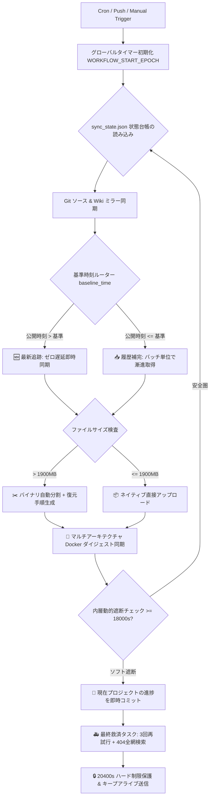

<div align="center">

<h1>⚡ MIRROR HUB</h1>

<p>
  <strong>エンタープライズ級 OSS 資産自動ミラーリング・災害復旧・全網救済エンジン</strong>
</p>

<p>
  <a href="./">简体中文</a> &nbsp;•&nbsp;
  <a href="./README_TW.md">繁體中文</a> &nbsp;•&nbsp;
  <a href="./README_EN.md">English</a> &nbsp;•&nbsp;
  <b>日本語</b> &nbsp;•&nbsp;
  <a href="./README_KO.md">한국어</a>
</p>

<p align="center">
  <a href="../../actions"></a>
  <a href="./sync_state.json"></a>
  <a href="./.github/workflows/batch-mirror.yml"></a>
  <a href="./.github/workflows/batch-mirror.yml"></a>
</p>

<p>
  <a href="../../wiki/Home-ja">📘 <b>コア技術マニュアル (Wiki)</b></a> &nbsp;|&nbsp;
  <a href="../../actions">🚀 <b>実行モニター (Actions)</b></a> &nbsp;|&nbsp;
  <a href="./sync_state.json">📒 <b>状態台帳 (JSON)</b></a>
</p>

</div>

---

### 🏗️ システムアーキテクチャと実行フロー



---

### 📊 エンジニアリング機能マトリクス

| アーキテクチャ軸 | 従来の同期スクリプトの課題 | Mirror Hub の解決策 |
| :--- | :--- | :--- |
| **タイムアウト制御** | GitHub の6時間強制終了で進捗が全損 | **3層動的遮断**：内外ループ監視 + 動的残り時間計算 + 20分安全マージン |
| **大容量ファイル** | 2GB超の単一ファイルで API エラー発生 | **無劣化バイナリ分割**：`>1900MB` を `.part_000` に自動分割し復元コマンドを追記 |
| **増分戦略** | 全件スキャンによる API レート制限の枯渇 | **デュアルトラック基準**：`baseline_time` を固定し最新追跡と履歴補完を分離 |
| **ソース削除対策** | 開発元がリポジトリやタグを削除 (404) すると喪失 | **全網救済エンジン**：公開ミラーを自動検索して救出し、絶版は `archived_dead` へ記録 |
| **並行処理安全性** | 実行中の手動編集で末尾の `git push` が競合失敗 | **楽観的リベース再試行**：`git pull --rebase --autostash` を最大3回自動実行 |

---

### 🚀 クイックデプロイ

#### 1. 権限シークレットの設定 (`MIRROR_TOKEN`)
`Settings` ➔ `Secrets and variables` ➔ `Actions` ➔ `New repository secret`：
- **Name**: `MIRROR_TOKEN`
- **Scopes**: `repo`、`workflow`、`write:packages`、`read:packages`

#### 2. 同期トポロジの定義 (`repos.txt`)
```text
# 構文：ソースGitHubリポジトリ | ソースDockerイメージ | ターゲットリポジトリ名 | 同期Dockerタグ数
# 該当なしの場合は none を指定
dify-ai/dify | langgenius/dify-api | dify | 5
n8n-io/n8n | n8nio/n8n | n8n | 5
torvalds/linux | none | linux-kernel | 0
```

<details>
<summary><b>🧩 展開：分割ファイル (>2GB) 復元プロトコル</b></summary>
<br>

`1900MB` を超えるアセットは自動的に `ファイル名.part_000`、`ファイル名.part_001` に分割されます。すべてのパーツを同一ディレクトリにダウンロードし、以下を実行してください：

- **Linux / macOS (POSIX)**:
  ```bash
  cat ファイル名.part_* > ファイル名
  ```
- **Windows (CMD)**:
  ```cmd
  copy /b ファイル名.part_* ファイル名
  ```
</details>
