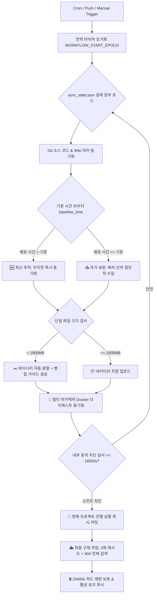

<div align="center">

<h1>⚡ MIRROR HUB</h1>

<p>
  <strong>엔터프라이즈급 오픈소스 자산 자동 미러링·재해 복구·전체 네트워크 구조 엔진</strong>
</p>

<p>
  <a href="./">简体中文</a> &nbsp;•&nbsp;
  <a href="./README_TW.md">繁體中文</a> &nbsp;•&nbsp;
  <a href="./README_EN.md">English</a> &nbsp;•&nbsp;
  <a href="./README_JA.md">日本語</a> &nbsp;•&nbsp;
  <b>한국어</b>
</p>

<p align="center">
  <a href="../../actions"></a>
  <a href="./sync_state.json"></a>
  <a href="./.github/workflows/batch-mirror.yml"></a>
  <a href="./.github/workflows/batch-mirror.yml"></a>
</p>

<p>
  <a href="../../wiki/Home-ko">📘 <b>핵심 기술 매뉴얼 (Wiki)</b></a> &nbsp;|&nbsp;
  <a href="../../actions">🚀 <b>실행 모니터 (Actions)</b></a> &nbsp;|&nbsp;
  <a href="./sync_state.json">📒 <b>상태 장부 (JSON)</b></a>
</p>

</div>

---

### 🏗️ 시스템 아키텍처 및 실행 흐름



---

### 📊 핵심 엔지니어링 역량 매트릭스

| 아키텍처 차원 | 기존 미러링 스크립트의 한계 | Mirror Hub 엔지니어링 솔루션 |
| :--- | :--- | :--- |
| **타임아웃 제어** | GitHub 6시간 강제 종료 시 동기화 진행률 전량 유실 | **3중 동적 차단기**: 내/외부 루프 감시 + 동적 남은 시간 계산 + 20분 안전 버퍼 |
| **초대용량 파일** | 2GB 초과 단일 파일 업로드 시 API 오류로 영구 누락 | **무손실 바이너리 분할**: `>1900MB` 자산을 `.part_000`으로 자동 분할 및 복원 명령 삽입 |
| **증분 전략** | 전체 API 스캔으로 인한 호출 한도(Rate Limit) 고갈 | **듀얼 트랙 기준선**: `baseline_time` 고정으로 최신 버전 즉시 추적 및 과거 버전 분할 수집 |
| **원본 저장소 삭제** | 원본 저장소 또는 태그 삭제(404) 시 복구 불가 | **전체 네트워크 구조**: 공개 미러 저장소 자동 검색 및 복구, 영구 유실 시 `archived_dead` 기록 |
| **동시성 안전** | 실행 중 수동 편집으로 인한 마지막 `git push` 충돌 | **낙관적 리베이스 재시도**: `git pull --rebase --autostash` 최대 3회 자동 백오프 재시도 |

---

### 🚀 빠른 배포 가이드

#### 1. 권한 시크릿 설정 (`MIRROR_TOKEN`)
`Settings` ➔ `Secrets and variables` ➔ `Actions` ➔ `New repository secret` 이동 후 생성:
- **Name**: `MIRROR_TOKEN`
- **Scopes**: `repo`, `workflow`, `write:packages`, `read:packages` 필수 체크

#### 2. 동기화 토폴로지 정의 (`repos.txt`)
```text
# 구문: 원본GitHub저장소 | 원본Docker이미지 | 대상저장소이름 | 동기화할Docker태그수
# 해당 사항이 없으면 none 입력
dify-ai/dify | langgenius/dify-api | dify | 5
n8n-io/n8n | n8nio/n8n | n8n | 5
torvalds/linux | none | linux-kernel | 0
```

<details>
<summary><b>🧩 펼치기: 초대용량 파일 (>2GB) 병합 프로토콜</b></summary>
<br>

`1900MB`를 초과하는 단일 파일은 자동으로 `파일명.part_000`, `파일명.part_001` 등으로 분할됩니다. 모든 분할 파일을 동일한 디렉터리에 다운로드한 후 실행하세요:

- **Linux / macOS (POSIX)**:
  ```bash
  cat 파일명.part_* > 파일명
  ```
- **Windows (CMD)**:
  ```cmd
  copy /b 파일명.part_* 파일명
  ```
</details>
