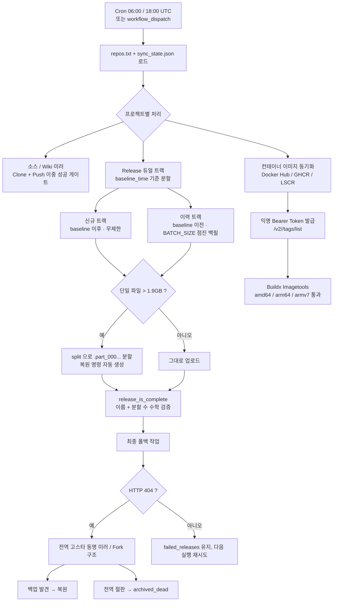

<div align="center">

<!-- 히어로 배너 -->


<p align="center">
  <strong>핵심 오픈소스 인프라의 소스코드, Wiki, 전체 Release 바이너리, 멀티 아키텍처 컨테이너 이미지를 영구 아카이빙합니다.</strong>
</p>

<!-- 듀얼 톤 배지 -->
<p align="center">
  <a href="../../actions"></a>
  <a href="./sync_state.json"></a>
  <a href="./batch-mirror.yml">1.9GB CHUNKS"></a>
  <a href="../../wiki/Troubleshooting-and-Maintenance"></a>
  <a href="../../packages"></a>
</p>

<!-- 언어 전환 -->
<p align="center">
  <a href="../../">简体中文</a> &nbsp;│&nbsp;
  <a href="./README_TW.md">繁體中文</a> &nbsp;│&nbsp;
  <a href="./README_EN.md">English</a> &nbsp;│&nbsp;
  <a href="./README_JA.md">日本語</a> &nbsp;│&nbsp;
  <strong>한국어</strong>
</p>

<!-- 바로가기 -->
<p align="center">
  <a href="../../wiki"><strong>📖 Wiki</strong></a> &nbsp;│&nbsp;
  <a href="./repos.txt"><strong>⚙️ 미러 목록</strong></a> &nbsp;│&nbsp;
  <a href="./sync_state.json"><strong>📊 상태 원장</strong></a> &nbsp;│&nbsp;
  <a href="../../issues"><strong>🐛 이슈</strong></a>
</p>

</div>

---

## 개요

업스트림 저장소의 갑작스러운 삭제, 과거 Release 첨부 파일 정리, 단일 파일의 GitHub `2GB` 제한 초과, 멀티 아키텍처 이미지 pull 제한 — 이는 셀프호스팅과 기업 내부망 인프라가 실제로 마주하는 단일 장애점입니다.

**OmniMirror Hub** 는 단순한 정기 동기화 스크립트가 아니라, 프로덕션 수준의 한계 테스트를 거친 **전량 점진형 재해복구 제어 아키텍처**입니다. **듀얼 트랙 스케줄링**, **1.9GB 스마트 바이너리 분할**, **수학적 자산 무결성 검증**, **전역 404 자동 구조**를 통해 사람의 개입 없이 업스트림 자산을 영구적으로 관리 가능한 미러 라이브러리로 축적합니다.

---

## 아키텍처



---

## 핵심 기능

<table>
  <tr>
    <td width="50%" valign="top">
      <h3>⚡ 듀얼 트랙 스케줄링</h3>
      <p>최초 구축 시점의 <code>baseline_time</code> 을 경계로, <strong>신규 트랙</strong>은 이후 Release 를 지연 없이 무제한 동기화하고, <strong>이력 트랙</strong>은 이전 버전을 <code>BATCH_SIZE</code>(기본 회당 15개)로 점진 백필하여 GitHub API 5000/h 제한을 피하면서 결국 100% 아카이빙합니다.</p>
    </td>
    <td width="50%" valign="top">
      <h3>✂️ 2GB 한계 돌파와 검증</h3>
      <p><code>1.9GB</code> 초과 파일은 <code>split</code> 으로 분할(<code>.part_000...</code>)하고 Linux/macOS·Windows CMD 복원 명령을 Release 설명에 자동 기록합니다. <code>release_is_complete</code> 는 소스 바이트 수로 필요 분할 수 N 을 계산해 중단으로 생긴 반쪽 Release 를 감지·재구성합니다.</p>
    </td>
  </tr>
  <tr>
    <td width="50%" valign="top">
      <h3>🚑 Anti-404 전역 구조</h3>
      <p><code>403/429/5xx</code> 일시 제한과 실제 <code>404</code> 삭제를 엄격히 구분합니다. 이미 미러된 절판 자산은 절대 보호되며, 소스가 <code>404</code> 이고 로컬에 없을 때만 전역 고스타 동명 미러/Fork 를 검색해 복구하고, 그래도 없으면 <code>archived_dead</code> 로 아카이빙합니다.</p>
    </td>
    <td width="50%" valign="top">
      <h3>🐳 크로스 레지스트리 멀티 아키텍처</h3>
      <p>Docker Hub, GHCR(<code>ghcr.io</code>), LinuxServer(<code>lscr.io</code>) 등 지원. 익명 Bearer Token 교환과 실제 태그 조회(<code>/v2/&lt;repo&gt;/tags/list</code>), Buildx Imagetools 로 <code>amd64</code> / <code>arm64</code> / <code>armv7</code> Manifest 를 재빌드 없이 전달합니다.</p>
    </td>
  </tr>
  <tr>
    <td width="50%" valign="top">
      <h3>🔒 동시성 잠금과 원자 원장</h3>
      <p>전역 <code>concurrency</code> 큐 잠금 + <code>fetch-depth: 0</code> + <code>safe_jq</code> 원자 쓰기 검증으로 동시 실행 충돌과 <code>sync_state.json</code> 손상을 방지합니다.</p>
    </td>
    <td width="50%" valign="top">
      <h3>⏱️ 서킷 브레이커와 킵얼라이브</h3>
      <p>메인 루프는 5시간(18000s)에 우아하게 중단되고, 5시간 40분(20400s) 전역 안전선에서 최종 커밋합니다. 60일 무활동 비활성화도 방지합니다.</p>
    </td>
  </tr>
</table>

---

## 왜 OmniMirror Hub 인가?

| 관점 | 일반 동기화 스크립트 | **OmniMirror Hub** |
| :--- | :--- | :--- |
| **대형 소스 저장소** | 타임아웃 시 진행 손실, 동기화 완료로 오기록 | **Clone + Push 이중 성공 게이트**, 자동 재시도 |
| **거대 Release 첨부** | GitHub 2GB 단일 파일 제한으로 즉시 오류 | **1.9GB 자동 분할** + 전 플랫폼 복원 명령 |
| **반쪽 Release** | 동일 태그 발견 시 영구 스킵 | **이름 + 분할 수 수학 검증**으로 삭제·재구성 |
| **업스트림 삭제** | 404 시 중단, 또는 로컬 아카이브 오삭제 | **로컬 절판 자산 절대 보호** + 전역 구조 |
| **동시성과 원장** | 동시 실행 시 JSON 손상 | **전역 Concurrency 잠금** + `safe_jq` 원자 쓰기 |

---

## 빠른 시작

### 1. 자격 증명 설정

**`Settings` → `Secrets and variables` → `Actions`** 에서 추가:

| Secret | 권한 | 용도 |
| :--- | :--- | :--- |
| `MIRROR_TOKEN` | `repo`, `workflow`, `write:packages` | 저장소 생성, 소스/Wiki 푸시, Release 게시, 이미지 푸시 |

### 2. 동기화 목록 `repos.txt`

```text
# 형식: GitHub 소스 | 컨테이너 이미지 소스 | 대상 저장소 | 유지할 최신 태그 수
n8n-io/n8n          | docker.n8n.io/n8nio/n8n | n8n      | 10
langgenius/dify     | langgenius/dify-api      | dify-api | 15
none                | langgenius/dify-web      | dify-web | 15
siyuan-note/siyuan  | b3log/siyuan             | siyuan   | 10
```

- `#` 주석과 빈 줄 지원；
- 이미지 전용 프로젝트는 첫 열에 `none`；
- 자세한 내용은 [구성 가이드](https://github.com/OWNER/REPO/wiki/Configuration-Guide).

### 3. 워크플로 실행

- **정기 실행**: 매일 `06:00 UTC`, `18:00 UTC`；
- **수동 실행**: `Actions` → `全量渐进式总控搬运` → `Run workflow`, `batch_size`(기본 `15`) 지정 가능.

---

## 고급 사용

<details>
<summary><strong>📦 1.9GB 초과 분할 파일 복원 방법</strong></summary>
<br/>

`1.9GB` 초과 파일은 `filename.ext.part_000`, `filename.ext.part_001`… 로 분할됩니다. 모든 파트를 같은 디렉터리에 받은 뒤 병합하세요:

```bash
# Linux / macOS
cat filename.ext.part_* > filename.ext
```

```cmd
:: Windows CMD
copy /b filename.ext.part_* filename.ext
```

</details>

<details>
<summary><strong>📊 상태 원장 <code>sync_state.json</code> 읽기</strong></summary>
<br/>

`safe_jq` 가 원자적으로 유지합니다. 주요 필드:

| 필드 | 의미 |
| :--- | :--- |
| `baseline_time` | 최초 구축 시각. 신규/이력 경계 |
| `synced_releases` | 무결성 검증 후 아카이빙된 Release 태그 |
| `failed_releases` | 일시 실패 큐. 폴백에서 재시도 |
| `archived_dead` | 전역 절판으로 확인된 기록 |
| `synced_images` | 이미지 태그 → `{digest, sync_time}` |
| `last_repo_push` | 마지막 소스 미러 성공 시 `pushed_at` |
| `repo_dead` | 소스 404 마커(매 실행 재확인) |
| `history_completed` | 이력 전량 아카이빙 여부(사람용) |

</details>

<details>
<summary><strong>🛡️ 서킷 브레이커와 쿼터 보호</strong></summary>
<br/>

* **메인 중단**: `18000s`(5h)에서 우아하게 중단하고 진행 저장 후 폴백으로 전환；
* **전역 안전선**: `20400s`(5h40m)에서 최종 커밋, Actions 6h 강제 종료로 인한 손실 방지；
* **킵얼라이브**: 매 실행 `.github/.last_run` 기록으로 60일 비활성화 방지.

</details>

<details>
<summary><strong>🔁 과거 "가짜 성공" 비파괴 점검(선택)</strong></summary>
<br/>

구버전이 반쪽 Release 를 동기화 완료로 오기록했을 수 있다면, `synced_releases` 를 임시로 `failed_releases` 로 옮겨 새 무결성 검사를 다시 트리거하세요:

```bash
cp sync_state.json "sync_state.json.bak.$(date +%Y%m%d%H%M%S)"
jq 'with_entries(.value |= (
  .failed_releases = ((.failed_releases // []) + ((.synced_releases // []) | map({"tag": .}))) | unique_by(.tag)
  | .synced_releases = []
  | .history_completed = false
))' sync_state.json > tmp.json && mv tmp.json sync_state.json
```

완전한 버전은 즉시 통과해 `synced_releases` 로 돌아가고, 반쪽은 삭제·재구성됩니다. 자세한 내용은 [문제 해결 가이드](https://github.com/OWNER/REPO/wiki/Troubleshooting-and-Maintenance).

</details>

---

## 문서

| 문서 | 내용 |
| :--- | :--- |
| **[Wiki 홈](https://github.com/OWNER/REPO/wiki)** | 시스템 개요 |
| **[구성 가이드](https://github.com/OWNER/REPO/wiki/Configuration-Guide)** | `repos.txt` 와 권한 |
| **[아키텍처와 알고리즘](https://github.com/OWNER/REPO/wiki/Architecture-and-Algorithms)** | 듀얼 트랙, 분할 검증, Anti-404 |
| **[문제 해결과 유지보수](https://github.com/OWNER/REPO/wiki/Troubleshooting-and-Maintenance)** | 원장, 점검 복구, 레이트 리밋 |

<br/>

<div align="center">
  <sub>© 2025 OmniMirror Hub · Released under the MIT License · Powered by GitHub Actions</sub>
</div>

<!-- 푸터 웨이브 배너 (히어로와 대칭) -->
<div align="center">
  
</div>
