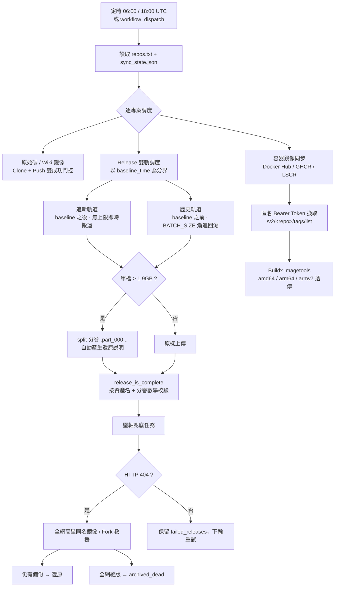

<div align="center">

<!-- 頂部流光漸變動態波浪 Banner -->


<p align="center">
  <strong>為關鍵開源基礎設施提供原始碼、Wiki、全量 Release 二進位檔及多架構容器鏡像的永久性容災歸檔</strong>
</p>

<!-- 高對比雙色拼接徽章 -->
<p align="center">
  <a href="../../actions"></a>
  <a href="../../packages"></a>
  <a href="./sync_state.json"></a>
  <a href="./batch-mirror.yml"></a>
  <a href="./LICENSE"></a>
</p>

<!-- 多語言切換 -->
<p align="center">
  <a href="../../">简体中文</a> &nbsp;│&nbsp;
  <strong>繁體中文</strong> &nbsp;│&nbsp;
  <a href="./README_EN.md">English</a> &nbsp;│&nbsp;
  <a href="./README_JA.md">日本語</a> &nbsp;│&nbsp;
  <a href="./README_KO.md">한국어</a>
</p>

<!-- 快捷入口 -->
<p align="center">
  <a href="../../wiki"><strong>📖 Wiki 文件</strong></a> &nbsp;│&nbsp;
  <a href="./repos.txt"><strong>⚙️ 鏡像清單</strong></a> &nbsp;│&nbsp;
  <a href="./sync_state.json"><strong>📊 狀態帳本</strong></a> &nbsp;│&nbsp;
  <a href="../../issues"><strong>🐛 問題回報</strong></a>
</p>

</div>

---

## 概述

上游倉庫突然刪庫、歷史 Release 附件被清理、單檔突破 GitHub `2GB` 限制、多架構容器鏡像拉取受限——這些都是自架與企業內網基礎設施面臨的真實單點故障風險。

**OmniMirror Hub** 不是單純的定時同步腳本，而是一套經過生產級極限壓測的**全量漸進式容災總控架構**。它透過**雙軌並發調度**、**1.9GB 智慧二進位分卷**、**數學級資產完整性校驗**以及**全網 404 自動搶救機制**，在完全零人工介入的前提下，把上游動態演進的軟體資產沉澱為永久可控的私有/公有鏡像庫。

---

## 核心架構



---

## 核心能力

<table>
  <tr>
    <td width="50%" valign="top">
      <h3>⚡ 雙軌制並發調度引擎</h3>
      <p>以首次建檔鎖定的 <code>baseline_time</code> 為分界線：<strong>追新軌道</strong>對之後新發布的 Release 零延遲、無上限搬運；<strong>歷史軌道</strong>對之前的存量版本按 <code>BATCH_SIZE</code>（預設每輪 15 個）漸進回溯，既規避 GitHub API 5000/h 限流，又能長週期 100% 歸檔。</p>
    </td>
    <td width="50%" valign="top">
      <h3>✂️ 突破 2GB：分卷 + 數學校驗</h3>
      <p>單檔超過 <code>1.9GB</code> 自動執行 <code>split</code> 二進位分卷（<code>.part_000...</code>），並在 Release 說明中產生 Linux/macOS 與 Windows CMD 一鍵還原命令。<code>release_is_complete</code> 按來源端位元組數精確推算分卷數 N，自動識別並重建半成品，零誤傷。</p>
    </td>
  </tr>
  <tr>
    <td width="50%" valign="top">
      <h3>🚑 Anti-404 全網救援</h3>
      <p>嚴格區分 <code>403/429/5xx</code> 瞬時限流與真實 <code>404</code> 刪庫/刪版本。目標倉庫已入庫的絕版資產受絕對保護；確認來源端 <code>404</code> 且本地缺失時，自動檢索全網高星同名鏡像/Fork 搶救，仍無備份才歸檔 <code>archived_dead</code>。</p>
    </td>
    <td width="50%" valign="top">
      <h3>🐳 跨源多架構透傳</h3>
      <p>支援 Docker Hub、GHCR（<code>ghcr.io</code>）、LinuxServer（<code>lscr.io</code>）等主流 Registry。匿名 Bearer Token 自動換取 + <code>/v2/&lt;repo&gt;/tags/list</code> 真實標籤查詢，基於 Buildx Imagetools 實現 <code>amd64</code> / <code>arm64</code> / <code>armv7</code> 多架構 Manifest 秒級透傳。</p>
    </td>
  </tr>
  <tr>
    <td width="50%" valign="top">
      <h3>🔒 工業級並發鎖與原子帳本</h3>
      <p>全域 <code>concurrency</code> 佇列鎖 + <code>fetch-depth: 0</code> + <code>safe_jq</code> 原子寫入校驗，杜絕多任務並發衝突與 <code>sync_state.json</code> 損壞。</p>
    </td>
    <td width="50%" valign="top">
      <h3>⏱️ 熔斷保護與保活</h3>
      <p>主流程 5 小時（18000s）優雅熔斷，5 小時 40 分鐘（20400s）全域安全紅線收尾提交，自動保活記錄防止 60 天無操作停用。</p>
    </td>
  </tr>
</table>

---

## 為什麼選擇 OmniMirror Hub？

| 評估維度 | 傳統同步腳本 | **OmniMirror Hub** |
| :--- | :--- | :--- |
| **大倉庫原始碼同步** | 逾時中斷即遺失進度，甚至誤記為已同步 | **Clone + Push 雙成功門控**，失敗自動斷點重試 |
| **超大 Release 附件** | 觸發 GitHub 2GB 單檔限制直接報錯 | **1.9GB 自動二進位分卷**，隨附全平台還原指令 |
| **半成品殘缺修復** | 偵測到同名 Tag 即跳過，殘缺 Release 永久留存 | **按資產名 + 分卷數學公式校驗**，自動清除重建 |
| **上游刪庫/刪版本** | 遇 404 中斷，或誤刪本地既有存檔 | **本地絕版資產絕對保護** + 全網同名高星庫救援 |
| **並發與帳本安全** | 多任務並發導致 JSON 衝突損壞 | **全域 Concurrency 鎖** + `safe_jq` 原子寫 |

---

## 快速開始

### 1. 設定存取憑證

前往倉庫 **`Settings` → `Secrets and variables` → `Actions`**，新增：

| Secret | 權限 | 用途 |
| :--- | :--- | :--- |
| `MIRROR_TOKEN` | `repo`, `workflow`, `write:packages` | 建立鏡像倉庫、推送原始碼/Wiki、發布 Release、推送容器鏡像 |

### 2. 定義同步清單 `repos.txt`

```text
# 格式：GitHub來源倉庫 | 容器鏡像來源 | 目標倉庫名 | 鏡像拉取最近Tag數
n8n-io/n8n          | docker.n8n.io/n8nio/n8n | n8n      | 10
langgenius/dify     | langgenius/dify-api      | dify-api | 15
none                | langgenius/dify-web      | dify-web | 15
siyuan-note/siyuan  | b3log/siyuan             | siyuan   | 10
```

- 支援 `#` 註解與空行；
- 純鏡像專案第一欄填 `none`；
- 詳見 [設定指南](https://github.com/OWNER/REPO/wiki/Configuration-Guide)。

### 3. 啟動工作流

- **週期調度**：每日 `06:00 UTC` 與 `18:00 UTC` 自動巡檢；
- **手動觸發**：`Actions` → `全量渐进式总控搬运` → `Run workflow`，可傳 `batch_size`（預設 `15`）。

---

## 進階說明

<details>
<summary><strong>📦 如何還原超過 1.9GB 的自動分卷檔案？</strong></summary>
<br/>

系統會將超過 `1.9GB` 的單檔切割為 `filename.ext.part_000`、`filename.ext.part_001`…。把同一檔案全部分卷下載到同一目錄後合併：

```bash
# Linux / macOS
cat filename.ext.part_* > filename.ext
```

```cmd
:: Windows CMD
copy /b filename.ext.part_* filename.ext
```

</details>

<details>
<summary><strong>📊 如何閱讀狀態帳本 <code>sync_state.json</code>？</strong></summary>
<br/>

由 `safe_jq` 原子維護，核心欄位：

| 欄位 | 含義 |
| :--- | :--- |
| `baseline_time` | 首次建檔時間，區分追新/歷史軌道的基準線 |
| `synced_releases` | 已通過完整性校驗並歸檔的 Release Tag |
| `failed_releases` | 瞬時失敗佇列，壓軸兜底任務自動重試 |
| `archived_dead` | 全網確認絕版後的歸檔記錄 |
| `synced_images` | 鏡像 Tag → `{digest, sync_time}` |
| `last_repo_push` | 上次原始碼鏡像成功時的 `pushed_at` |
| `repo_dead` | 來源倉庫確認 404 的標記（每輪仍會複核） |
| `history_completed` | 歷史版本是否全部歸檔的人讀標記 |

</details>

<details>
<summary><strong>🛡️ 熔斷與配額保護機制</strong></summary>
<br/>

* **主流程熔斷**：執行滿 `18000s`（5h）優雅暫停並儲存進度，讓位給兜底階段；
* **全域安全紅線**：`20400s`（5h40m）強制收尾提交，避免 GitHub Actions 6h 強殺丟進度；
* **保活**：每輪寫入 `.github/.last_run`，防止 60 天無操作停用。

</details>

<details>
<summary><strong>🔁 歷史假成功的無損體檢（選用）</strong></summary>
<br/>

若懷疑舊版曾把半成品誤記入 `synced_releases`，可將其臨時回填到 `failed_releases` 觸發新版完整性複檢：

```bash
cp sync_state.json "sync_state.json.bak.$(date +%Y%m%d%H%M%S)"
jq 'with_entries(.value |= (
  .failed_releases = ((.failed_releases // []) + ((.synced_releases // []) | map({"tag": .}))) | unique_by(.tag)
  | .synced_releases = []
  | .history_completed = false
))' sync_state.json > tmp.json && mv tmp.json sync_state.json
```

完整版本會秒過複檢並回填 `synced_releases`；殘缺版本自動刪除重建。詳見 [故障排查手冊](https://github.com/OWNER/REPO/wiki/Troubleshooting-and-Maintenance)。

</details>

---

## 文件導覽

| 文件 | 內容 |
| :--- | :--- |
| **[Wiki 首頁](https://github.com/OWNER/REPO/wiki)** | 系統全景與概念總覽 |
| **[設定指南](https://github.com/OWNER/REPO/wiki/Configuration-Guide)** | `repos.txt` 全場景與金鑰權限 |
| **[架構與演算法](https://github.com/OWNER/REPO/wiki/Architecture-and-Algorithms)** | 雙軌調度、分卷數學校驗、Anti-404 |
| **[故障排查與維運](https://github.com/OWNER/REPO/wiki/Troubleshooting-and-Maintenance)** | 帳本欄位、體檢還原、限流應對 |

<br/>

<div align="center">
  <sub>© 2025 OmniMirror Hub · Released under the MIT License · Powered by GitHub Actions</sub>
</div>

<!-- 底部動態波浪 Banner（與頂部首尾呼應） -->
<div align="center">
  
</div>
