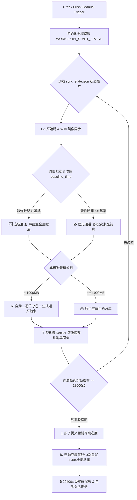

<div align="center">

<h1>⚡ MIRROR HUB</h1>

<p>
  <strong>企業級開源資產自動化鏡像、容災歸檔與全網救援引擎</strong>
</p>

<p>
  <a href="./README.md">简体中文</a> &nbsp;•&nbsp;
  <a href="./README_TW.md">繁體中文</a> &nbsp;•&nbsp;
  <a href="./README_EN.md"><b>English</b></a> &nbsp;•&nbsp;
  <a href="./README_JA.md">日本語</a> &nbsp;•&nbsp;
  <a href="./README_KO.md">한국어</a>
</p>

<p>
  <code>Engine: GitHub Actions</code> &nbsp;|&nbsp;
  <code>State Machine: JSON Ledger</code> &nbsp;|&nbsp;
  <code>Chunking: >1.9GB Auto-Split</code> &nbsp;|&nbsp;
  <code>Rescue: Cross-Repo 404 Recovery</code>
</p>

</div>

---

### 🏗️ 系統架構與執行流 (System Architecture)



---

### 📊 核心工程能力矩陣

| 架構維度 | 傳統搬運腳本痛點 | Mirror Hub 工程級解決方案 |
| :--- | :--- | :--- |
| **逾時控制** | 撞上 GitHub 6 小時強殺，已同步進度全部遺失 | **三層動態熔斷**：外層/內層雙迴圈即時探針 + 動態剩餘時間計算 + 20 分鐘安全緩衝 |
| **超大檔案** | 單檔案超 2GB 觸發介面報錯，版本永久缺失 | **串流二進位分卷**：自動識別 `>1900MB` 資產，無損切割為 `.part_000` 並注入還原手冊 |
| **增量策略** | 全量遍歷 API 極易觸發速率限制 (Rate Limit) | **雙軌制時間基準**：鎖定 `baseline_time`，新版本即時追新，歷史版本批次消化 |
| **源站刪庫** | 來源倉庫或歷史 Tag 被刪（404）後徹底失聯 | **全網救援引擎**：自動檢索 GitHub 全網高星備份庫搶救恢復，絕版資產歸檔至 `archived_dead` |
| **並發安全** | 運行期間修改清單導致末尾 `git push` 衝突報錯 | **樂觀鎖變基重試**：自動執行 `git pull --rebase --autostash` 三次退避重試 |

---

### 🚀 快速部署指南

#### 1. 配置權限金鑰 (`MIRROR_TOKEN`)
進入倉庫 `Settings` ➔ `Secrets and variables` ➔ `Actions` ➔ `New repository secret`：
- **Name**: `MIRROR_TOKEN`
- **Scopes**: 必須勾選 `repo`、`workflow`、`write:packages`、`read:packages`

#### 2. 定義同步拓撲 (`repos.txt`)
```text
# 語法規範：來源GitHub倉庫 | 來源Docker鏡像 | 目標倉庫名 | 每次同步Docker標籤數
# 無對應源請填寫 none
dify-ai/dify | langgenius/dify-api | dify | 5
n8n-io/n8n | n8nio/n8n | n8n | 5
torvalds/linux | none | linux-kernel | 0
```

<details>
<summary><b>🧩 點擊展開：超大檔案分卷 (>2GB) 還原協議</b></summary>
<br>

當上游 Release 包含超過 `1900MB` 的單一資產時，系統會自動生成 `檔名.part_000`、`檔名.part_001` 等分卷，並在對應 Release 頁面底部注入校驗指引。下載全部分卷至同一目錄後執行：

- **Linux / macOS (POSIX)**:
  ```bash
  cat 檔名.part_* > 檔名
  ```
- **Windows (CMD)**:
  ```cmd
  copy /b 檔名.part_* 檔名
  ```
</details>
